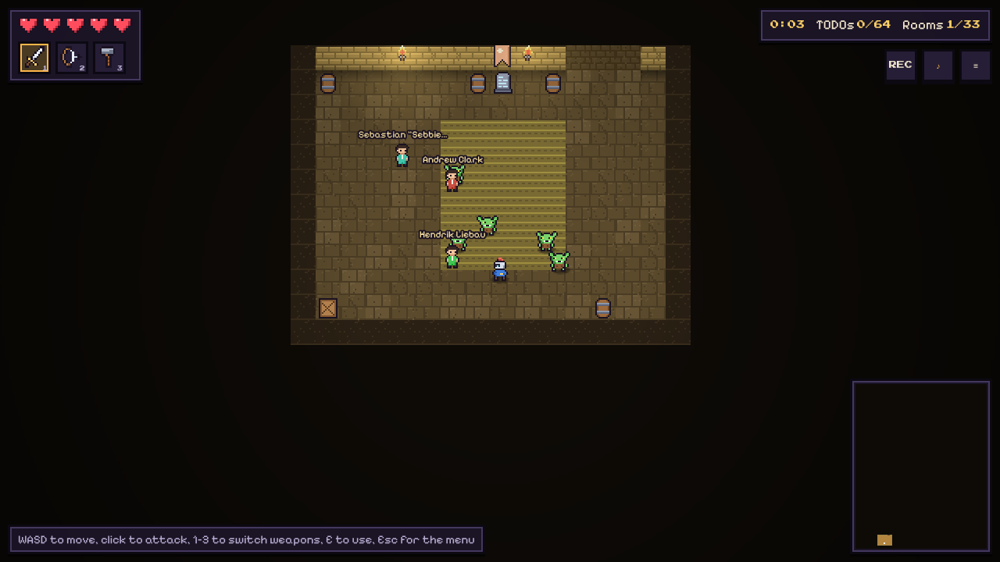
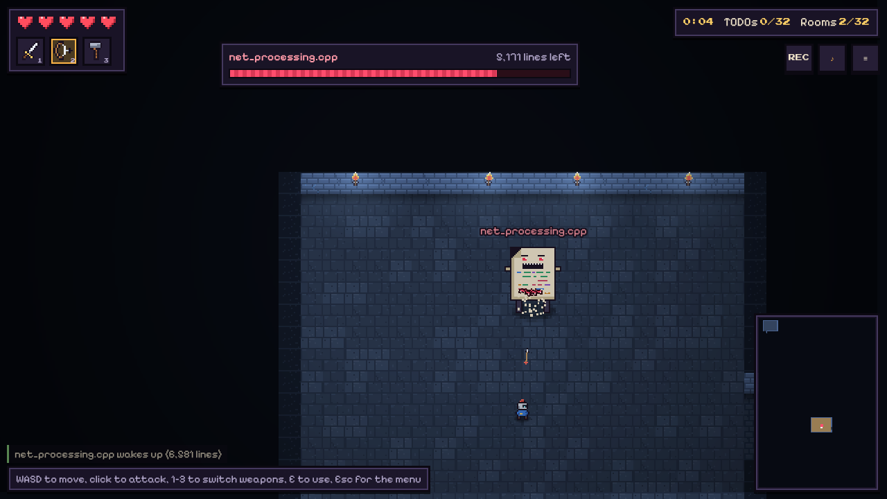
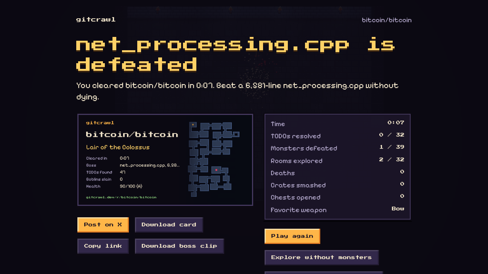
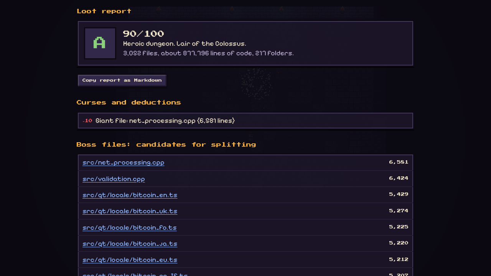

# gitcrawl

[](https://www.npmjs.com/package/gitcrawl-cli)

Paste any GitHub repo and play it as a dungeon in the browser.

Folders become rooms, the biggest file is the boss, every `TODO` is a goblin, open issues haunt the halls as ghosts, stale branches rattle around a crypt, and the lockfile is a bottomless pit. Every monster is a real finding, so when the run ends you get a loot report: the files to split, the oldest TODOs, the branches to prune and the issues where newcomers can start.



## What's in the box

- **Any public repo, no login.** Paste `owner/repo` or a GitHub link. The server builds the dungeon from the GitHub API and caches it; if the server is busy, the browser builds it itself.
- **Real content as monsters.** TODO/FIXME/HACK comments are goblins that shout their text when they spot you. Big files are slimes and mini-bosses. The largest source file is the boss: its HP is its line count and it taunts you with its own code comments.
- **Light action.** Sword, bow and a refactor hammer. Chests with power-ups, a healing shrine in the tests folder, a license door in front of the treasury (no license means a cursed door that never opens), and contributor NPCs guarding the folders they commit to.
- **Explore mode** for people who just want to walk around and read.
- **Loot report** with links to the exact file and line, a 0–100 dungeon health score, and a Markdown export for issues.
- **Sharing built in.** Share card, link previews on X, a boss-kill clip recorded automatically during the fight, and a README badge that shows your dungeon health.
- **Versus mode**, a **daily raid**, leaderboards and a **Hall of Shame**.
- **Private code**: run `npx gitcrawl-cli` inside any repo. The dungeon is built on your machine and opened on localhost. Or connect a read-only GitHub App on the hosted site.
- **TODO Raid in your editor.** A VS Code and Cursor extension: your TODOs turn into goblins that hunt your text cursor. Fix the TODO to banish it.
- **No assets.** All pixel art, tiles, music and sound effects are generated in code.

| Boss fight | Victory | Loot report |
| --- | --- | --- |
|  |  |  |

## Run it

Requires Node 22+ and pnpm 10 (`corepack enable`).

```powershell
pnpm install
pnpm test
# web client on http://localhost:5173, API on http://localhost:8787
pnpm dev
```

Without a `GITHUB_TOKEN` the API falls back to GitHub's unauthenticated limit (60 requests/hour). Put a token in `apps/api/.env` or your shell:

```powershell
$env:GITHUB_TOKEN = "github_pat_..."; pnpm dev
```

Seed the cache with the bundled example dungeons so the site works before any API calls:

```powershell
pnpm --filter @gitcrawl/api seed
```

### Play a local or private repo

```powershell
pnpm build
node packages/cli/dist/main.js C:\code\my-app
```

Or use the published package from inside any repo:

```sh
npx gitcrawl-cli
```

It builds the dungeon on your machine and serves it on `http://localhost:4747`. Nothing leaves your machine. See [packages/cli](packages/cli) for options.

### TODO Raid for VS Code and Cursor


Install **gitcrawl: TODO Raid** from the VS Code Marketplace or Open VSX, open a file with TODOs and run **gitcrawl: Raid This File** from the Command Palette. Swing with **Shift+Space**. Source and build steps: [apps/vscode](apps/vscode).

### Static demo

```powershell
pnpm demo   # apps/web/dist-demo: bundled example dungeons, no server needed
```

## How it works

```
packages/shared   repo snapshot -> dungeon. Pure TypeScript, runs in Node and the browser.
  snapshot/github.ts   GitHub REST fetcher (full budget on the server, lite in the browser)
  scan.ts              TODO extraction, generated-file detection, boss taunt mining
  analyze.ts           boss pick, guardians, curses, health score, dungeon titles
  generate.ts          Hilbert-curve room layout, corridors, doors, entity placement
apps/web          Phaser 3 game + DOM HUD and pages (Vite)
apps/api          Fastify: cache, rate limits, leaderboards, OG images, badges, GitHub App auth
packages/cli      gitcrawl-cli: local git snapshot + localhost server
scripts           make-fixtures.ts builds the demo dungeons from real repos with git only
```

The same commit always produces the same dungeon: the layout is seeded from `owner/repo@sha`.

Layout: the entrance, every selected folder (depth first) and the boss lair are laid along a Hilbert curve, so consecutive rooms are always neighbours and related folders end up close together. Side rooms (treasury, crypt, pit) hang off that path and a few extra corridors add loops.

GitHub budget for an uncached repo is about 20 to 30 REST calls. File contents come from `raw.githubusercontent.com`, which doesn't count against the API limit. Results are cached for 24 hours.

## Deploy

One container serves everything (web app, API, link previews, badges). See [docs/DEPLOY.md](docs/DEPLOY.md) for Fly.io, the optional GitHub App for private repos, and pre-generating popular repos before launch.

## Docs

- [SPEC.md](SPEC.md): the product spec this was built from
- [IDEAS.md](IDEAS.md): what to improve next, and launch ideas
- [docs/DEPLOY.md](docs/DEPLOY.md): hosting and configuration

Fonts: Press Start 2P and Pixelify Sans, both under the SIL Open Font License.
